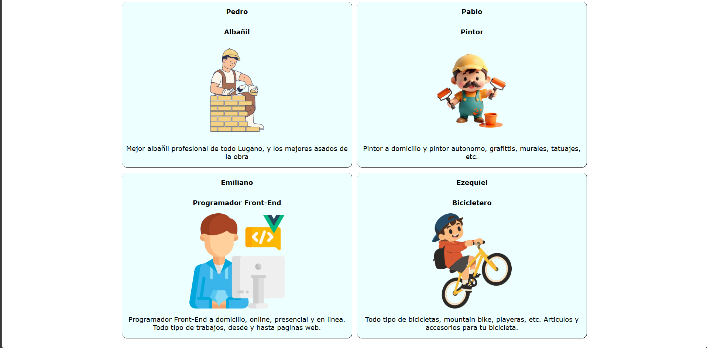

### DESCRIPCION BREVE PROYECTO
Proyecto donde se demuestra el uso de componentes en React, usando propiedades para el mismo (en este caso, tarjetas de "presentacion")

### CLONAR PROYECTO
Para clonar el proyecto, se usa, en la carpeta deseada desde nuestra terminal, ponemos lo siguiente:
git clone https://github.com/lucasbell275/UTN-Desarrollo-en-React-JS-181752-M2U1-Lucas-Daniel-Bell.git

### PARTE FINAL INSTALACION
Una vez que se clone, entramos dentro de la carpeta de nuestro proyecto y ponemos npm install.

### EJECUTAR SERVIDOR LOCAL
Para ejecutar un servidor local del proyecto, ponemos npm run dev en la terminal y ahi podremos ver el proyecto.

### DEMOSTRACION PROYECTO

### CREDITOS
Lucas Daniel Bell 181725 TN Modulo 2 Unidad 1